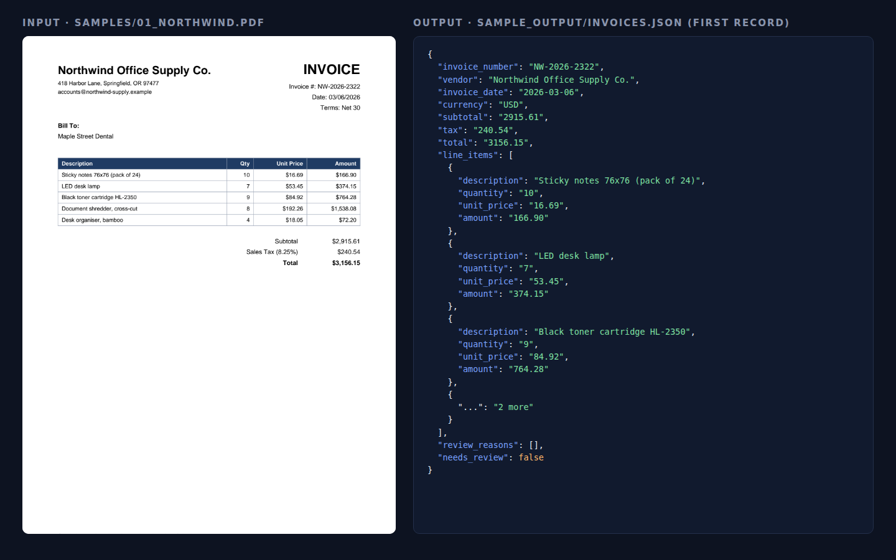
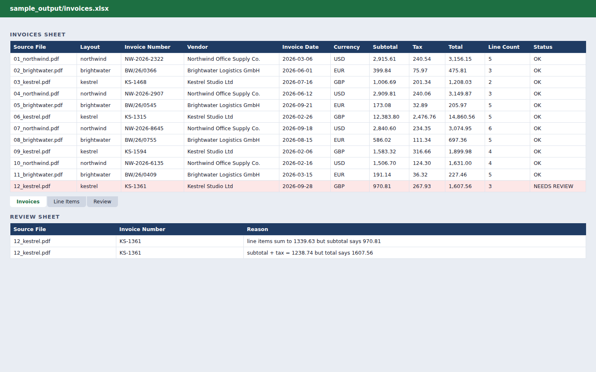
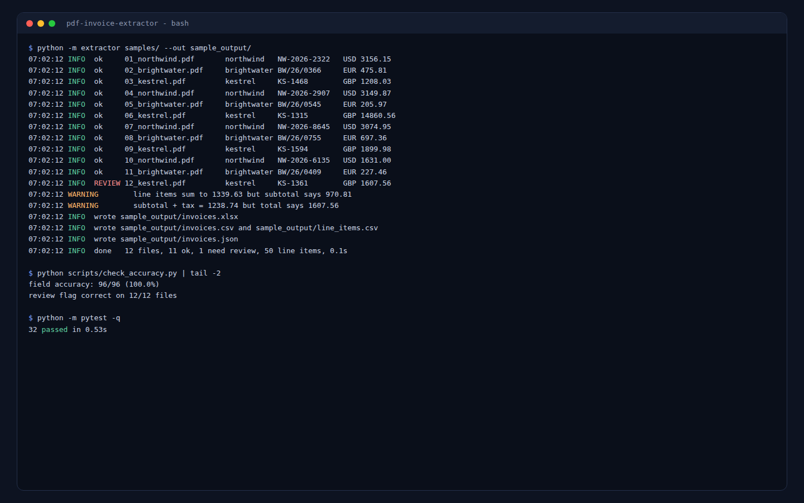

# PDF Invoice Extractor

Turn a folder of PDF invoices into a clean Excel workbook, CSV and JSON, with every invoice checked so bad data gets flagged for review instead of slipping through.



## What it extracts

For every invoice: **invoice number, vendor, date (normalised to ISO `YYYY-MM-DD`), currency, subtotal, tax, total** and every **line item** (description, quantity, unit price, amount).

It handles the formats real invoices use:

- `$1,234.50` (US), `1.234,50 EUR` (European) and `GBP 1,234.50` (UK)
- dates like `03/14/2026`, `14.03.2026`, `14 March 2026` and `2026-03-14`
- gridded tables, plain text columns, and `2 x Item @ price` line formats

## How it stays accurate

Extraction is only half the job. Each invoice is cross-checked before it is accepted:

| Check | What happens if it fails |
|---|---|
| quantity x unit price = line amount | flagged with the exact line |
| line items add up to the subtotal | flagged with both numbers |
| subtotal + tax = total | flagged with both numbers |
| a required field is missing | flagged by name |
| a date like `03/04/2026` with no layout hint | flagged as ambiguous, never guessed |
| scanned PDF (no text layer) or corrupt file | flagged, nothing invented |

Flagged invoices are still exported. They are highlighted in the **Invoices** sheet and listed with their reasons on a separate **Review** sheet.



Known vendor layouts get precise rules. Anything else goes through a generic parser (label and regex based) and is always marked for a quick human check.

## Results on the bundled samples

`samples/` holds 12 sample invoices in 3 different vendor layouts, generated by `scripts/generate_samples.py`. All companies are fictional. One sample (`12_kestrel.pdf`) deliberately has a vendor typo: its printed subtotal ignores a line.

```
$ python scripts/check_accuracy.py | tail -2
field accuracy: 96/96 (100.0%)
review flag correct on 12/12 files
```

The typo invoice is the one flagged for review, with both mismatches spelled out.



## Quick start

```bash
git clone https://github.com/Ali83128/pdf-invoice-extractor.git
cd pdf-invoice-extractor
python -m venv .venv && source .venv/bin/activate   # Windows: .venv\Scripts\activate
pip install -r requirements.txt

python -m extractor samples/ --out output/
```

Output:

```
output/
  invoices.xlsx     Invoices + Line Items + Review sheets (header, filters, currency formats)
  invoices.csv      one row per invoice
  line_items.csv    one row per line item
  invoices.json     full structured data, including review reasons
```

Options:

```
python -m extractor <file-or-folder> [--out DIR] [--format xlsx csv json]
```

## Project structure

```
extractor/
  parse.py      layout detection, per-layout rules, generic fallback
  numbers.py    money and date parsing (US / EU / UK formats)
  validate.py   cross-checks that produce review reasons
  export.py     Excel, CSV and JSON writers
  cli.py        command line interface
scripts/
  generate_samples.py   builds the sample invoices + ground truth
  check_accuracy.py     compares extraction with the ground truth
  render_screenshots.py renders the images in docs/screenshots
samples/        12 sample PDFs + ground_truth.json
sample_output/  real output from the run above
tests/          pytest suite
```

## Tests

```bash
pip install -r requirements-dev.txt   # screenshots also need: pip install playwright
python -m pytest -q
```

32 tests cover each layout, all 12 samples against the ground truth, money and date formats, ambiguous dates, every validation rule, scanned and corrupt PDFs, an unknown layout through the generic parser, and the CLI writing all output files.

## Out of scope (available as add-ons)

- **Scanned or photographed invoices.** These need an OCR step first. The extractor detects them and sends them to review rather than guessing.
- **Handwritten documents.**
- **New vendor layouts.** These work through the generic parser. A dedicated rule set for a high-volume vendor is a small add-on and removes the manual check.

---

Need invoices, receipts or statements pulled into Excel for your business? I build and adapt this kind of pipeline on Upwork.

## License

MIT, see [LICENSE](LICENSE).
